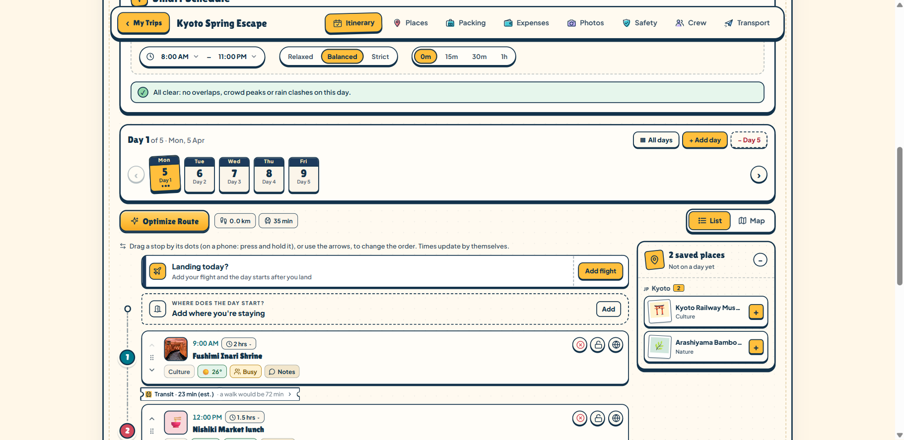
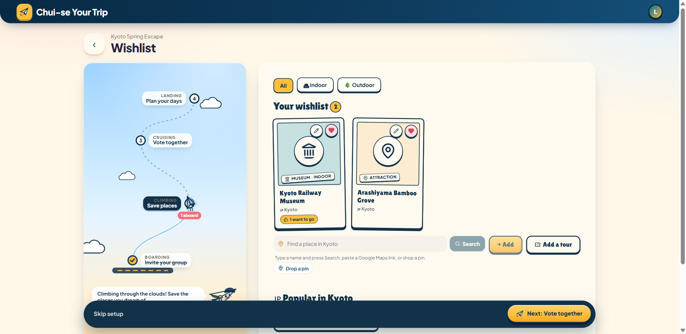
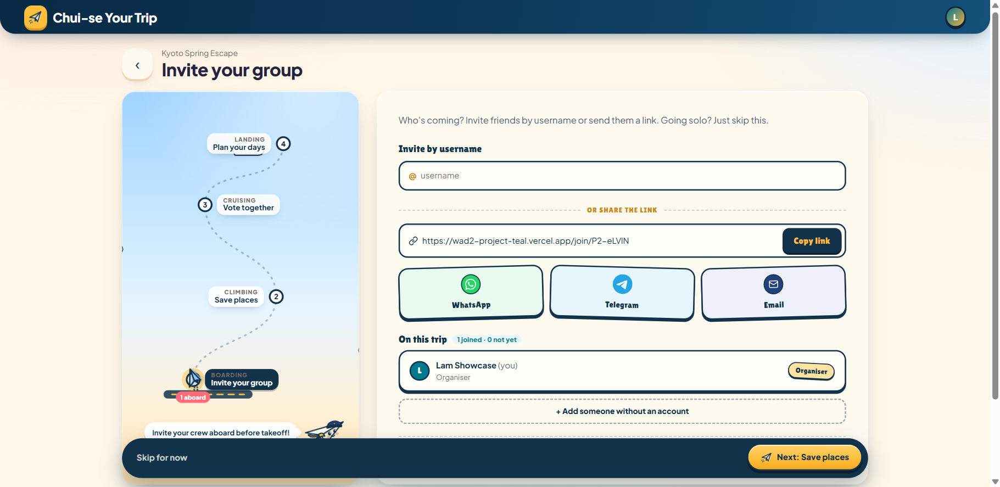
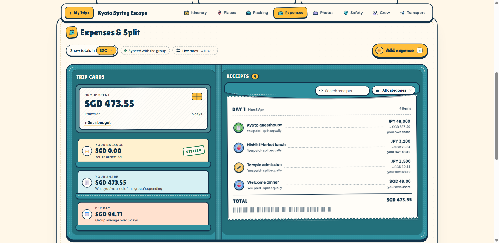
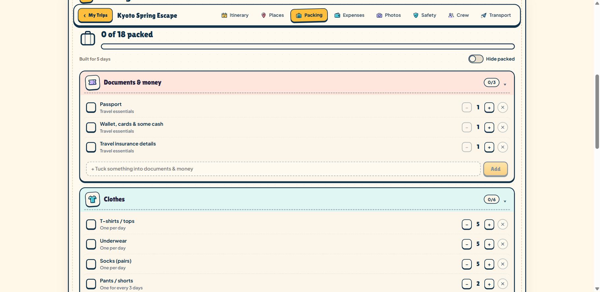

# Chui-se Your Trip

An adaptive travel planner for discovering destinations, coordinating group trips, and adjusting itineraries around weather, crowds, and travel disruptions.

[Open the production app](https://wad2-project-teal.vercel.app/)

## Contents

- [Screenshots](#screenshots)
- [Key features](#key-features)
  - [Accounts and personal settings](#1-accounts-and-personal-settings)
  - [Trip creation and management](#2-trip-creation-and-management)
  - [Discover destinations](#3-discover-destinations)
  - [Group planning, invitations, and voting](#4-group-planning-invitations-and-voting)
  - [Smart itinerary planning](#5-smart-itinerary-planning)
  - [Simulated weather and adaptive replanning](#6-simulated-weather-and-adaptive-replanning)
  - [Crowd-based recommendations](#7-crowd-based-recommendations)
  - [Flights and travel logistics](#8-flights-and-travel-logistics)
  - [Personalised packing checklist](#9-personalised-packing-checklist)
  - [Trip expenses and splitting](#10-trip-expenses-and-splitting)
  - [Shared photo memories and trip recap](#11-shared-photo-memories-and-trip-recap)
  - [Travel safety tools](#12-travel-safety-tools)
  - [Travel Twin avatar and rewards](#13-travel-twin-avatar-and-rewards)
  - [Friends, passport stamps, and guided tours](#14-friends-passport-stamps-and-guided-tours)
- [Tech stack](#tech-stack)
- [Project structure](#project-structure)
- [Running locally](#running-locally)
- [Deployment](#deployment)
- [Important notes](#important-notes)

## Screenshots

Core feature pages from the production app, using a dedicated showcase account and a sample Kyoto trip. All captures are **1821 × 887**; thumbnails display at **320 px wide** and link to the full image. The invitation link shown in the group screenshot has been reset.

<table>
  <tr>
    <td align="center"><a href="docs/screenshots/itinerary.png"></a><br><strong>Day-by-day itinerary</strong></td>
    <td align="center"><a href="docs/screenshots/wishlist.png"></a><br><strong>Saved places and wishlist</strong></td>
  </tr>
  <tr>
    <td align="center"><a href="docs/screenshots/group-planning.png"></a><br><strong>Group invitations</strong></td>
    <td align="center"><a href="docs/screenshots/expenses.png"></a><br><strong>Expenses and currency conversion</strong></td>
  </tr>
  <tr>
    <td align="center"><a href="docs/screenshots/packing.png"></a><br><strong>Personalised packing checklist</strong></td>
    <td></td>
  </tr>
</table>

## Key features

### 1. Accounts and personal settings

- Register, sign in with a username or email address, and sign out.
- Passwords are hashed with **bcryptjs**; authenticated API routes use **JSON Web Tokens (JWTs)**.
- Request password-reset codes by email when email delivery is configured.
- Update account details, contact information, dietary preferences, password, and notification preferences.
- Configure trip pacing, daily planning hours, time buffers, sensitivity to crowds, transport preferences, preferred currency, and metric/imperial units.
- Protect private pages using Vue Router navigation guards.

Source: [auth.js](server/routes/auth.js), [SettingsView.vue](src/views/SettingsView.vue), [preferences.js](server/routes/preferences.js), [index.js](src/router/index.js).

### 2. Trip creation and management

- Create solo or group trips with a name, one or more destinations, travel dates, and travellers.
- View trips in Planning, Upcoming, and Archive sections; search, sort, and filter them.
- Edit trip details and manage the itinerary throughout the trip.
- Follow a guided onboarding flow: Invite → Wishlist → Vote → Plan.

Source: [HomeView.vue](src/views/HomeView.vue), [trips.js](server/routes/trips.js), [TripSetupView.vue](src/views/TripSetupView.vue), [TripView.vue](src/views/TripView.vue).

### 3. Discover destinations

- Browse destinations and cities by region or continent.
- Filter and rank destination suggestions using travel dates, daily budget, and travel vibe.
- Explore destination cards, photographs, places of interest, and an interactive map experience.
- Use the destination-discovery quiz to explore suitable places.
- Turn a destination idea into a new trip.
- Display destination-related information from public sources where available, with graceful fallbacks.

Source: [DiscoverView.vue](src/views/DiscoverView.vue), [discover.js](server/routes/discover.js).

### 4. Group planning, invitations, and voting

- Share trip invitation links and invite existing users by username.
- Add travellers who do not yet have an account; manage invitations and group membership.
- Maintain crew details, roles, contact information, and flight and travel information.
- Save attractions, restaurants, and activities to a **shared wishlist**.
- Add custom places or booked tours with details such as time, duration, and booking links.
- Vote on proposed places; display counts and group preferences, including majority selections.
- Keep voting changes separate on the backend to reduce the risk of collaborators overwriting one another.

Source: [TripShare.vue](src/components/TripShare.vue), [CrewView.vue](src/components/CrewView.vue), [WishlistView.vue](src/components/WishlistView.vue), [PlacesVoting.vue](src/components/PlacesVoting.vue), [GroupVoting.vue](src/components/GroupVoting.vue), [trips.js](server/routes/trips.js), [join.js](server/routes/join.js).

### 5. Smart itinerary planning

- Build a day-by-day itinerary using scheduled stops, saved places, and a map.
- Drag stops to reorder the day, move saved places onto the schedule, or move them back to an unscheduled list.
- Add or remove trip days, set activity durations, and lock fixed-time bookings.
- View travel legs between stops, with transport options and estimated durations.
- Optimise the day using travel time, expected crowds, weather exposure, opening hours, fixed bookings, meal breaks, and pacing preferences.
- Compare original and suggested schedules, including explanations of schedule adjustments and timing conflicts.
- Use estimated transport times when a routing provider is unavailable.
- Save trip changes to MongoDB. When the client supplies an itinerary version, the backend checks it and rejects stale saves with HTTP 409.

Source: [ItineraryView.vue](src/components/ItineraryView.vue), [ItineraryPlanner.vue](src/components/ItineraryPlanner.vue), [dayOptimizer.js](src/dayOptimizer.js), [LegSheet.vue](src/components/LegSheet.vue), [trips.js](server/routes/trips.js).

### 6. Simulated weather and adaptive replanning

- Generate deterministic itinerary weather scenarios in `src/services/weatherService.js`, without an external weather API.
- Simulate rainy or sunny conditions at a selected stop.
- Highlight outdoor activities affected by rain.
- Explore rescheduling a stop into a drier time slot or replacing it with a suitable indoor place from the wishlist, subject to available options.
- Re-evaluate schedules in response to weather changes.
- Display separate climate information and optional API-backed forecasts alongside the local itinerary simulation.
- When a stop is selected, the simulation initially suggests the opposite of its original weather condition. For example, a stop originally occurring during clear weather will default to a rainy simulation.
- When the user selects an alternative time, the planner previews the change before saving it.
  - If moving the selected stop would affect later activities, the planner calculates the adjustments required for subsequent activities.
  - The preview records whether every required adjustment is possible. The change can only be applied when the complete set of adjustments is feasible.
  - When applied, the selected stop and all required adjustments are saved together.

Source: [weatherService.js](src/services/weatherService.js), [ItineraryView.vue](src/components/ItineraryView.vue), [ItineraryPlanner.vue](src/components/ItineraryPlanner.vue), [dayOptimizer.js](src/dayOptimizer.js).

### 7. Crowd-based recommendations

- Display crowd indicators for places and provide context on busier or quieter periods.
- Support simulated crowd conditions for itinerary demonstrations.
- Use BestTime-backed crowd data when configured, with estimated typical crowd patterns as a fallback.
- Factor crowd levels and user sensitivity into schedule optimisation.

Source: [frontend crowd helpers](src/crowd.js), [crowd API](server/routes/crowd.js), [ItineraryPlanner.vue](src/components/ItineraryPlanner.vue), [dayOptimizer.js](src/dayOptimizer.js).

### 8. Flights and travel logistics

- Record flights and transport details as part of trip planning.
- Check flight status and delay information via the optional Aviationstack integration.
- Demonstrate flight-delay cascading effects: a delayed arrival can shift transfer, hotel, and activity times or make a fixed deadline impossible to meet.
- Apply revised timings for affected itinerary stops in the flight-delay demonstration.
- Compare walking, public transport, taxi or ride-hailing, and cycling options, depending on travel preferences and route data.
- Plan and save additional point-to-point journeys outside the main itinerary.

Source: [FlightDelayWidget.vue](src/components/FlightDelayWidget.vue), [delayCascade.js](src/utils/delayCascade.js), [flights.js](server/routes/flights.js), [TravelChoices.vue](src/components/TravelChoices.vue), [LegSheet.vue](src/components/LegSheet.vue), [OtherJourneys.vue](src/components/OtherJourneys.vue), [travel.js](server/routes/travel.js).

### 9. Personalised packing checklist

- Generate suggested packing items from trip duration, expected weather, planned activities, and additional trip needs.
- Organise items into categories and track packing progress.
- Adjust quantities, add custom items, remove suggestions, and mark items as packed.
- Save packing changes for shared trips.

Source: [PackingView.vue](src/components/PackingView.vue), [packingList.js](src/packingList.js), [trips.js](server/routes/trips.js).

### 10. Trip expenses and splitting

- Record, edit, categorise, and delete shared trip expenses.
- Split expenses equally or allocate exact amounts to selected travellers.
- Track total spend, per-day spending, category breakdowns, and group budgets.
- Show who owes whom, record settlement payments, and undo settlements.
- Convert expenses into a home currency using fetched exchange rates or saved custom trip rates.
- Synchronise individual expense changes independently, helping concurrent group members avoid overwriting one another.

Source: [ExpensesView.vue](src/components/ExpensesView.vue), [ExpenseForm.vue](src/components/ExpenseForm.vue), [expense calculations](src/expenses.js), [expenses API](server/routes/expenses.js), [rates.js](server/routes/rates.js).

### 11. Shared photo memories and trip recap

- Upload photos to a trip's shared photo collection and organise them into albums.
- Browse photos by album or contributor; preview and react to photos.
- Download individual images or export the shared collection as a ZIP file.
- View a trip recap with route and trip statistics.
- Photo uploads support JPEG, PNG, WebP, and GIF, with a 10 MB per-photo backend limit.

Source: [PhotosView.vue](src/components/PhotosView.vue), [photos.js](server/routes/photos.js), [TripRecap.vue](src/components/TripRecap.vue), [trips.js](server/routes/trips.js).

### 12. Travel safety tools

- Display location-aware risk information, advisories, and relevant alerts when data is available.
- Search for nearby hospitals, clinics, police, fire stations, evacuation points, and embassy-related assistance.
- Provide emergency contact information, stay details, and guidance for unexpected situations.
- Include a clearly labelled safety simulation for scenarios such as earthquakes, typhoons, and raised travel advisories.
- Keep simulated safety events distinct from real safety alerts.

Source: [SafetyLayer.vue](src/components/SafetyLayer.vue), [SafetyRadar.vue](src/components/SafetyRadar.vue), [safety.js](server/routes/safety.js).

### 13. Travel Twin avatar and rewards

- Customise a Travel Twin avatar with different appearances and wardrobe items.
- Save outfits and choose trip-specific avatar looks visible in the crew experience.
- Earn experience points (XP) and unlock cosmetic rewards based on eligible travel-planning activities and completed trips.
- View avatar progress and personalisation options.

Source: [AvatarStudio.vue](src/components/AvatarStudio.vue), [avatar.js](server/routes/avatar.js), [SettingsView.vue](src/views/SettingsView.vue).

### 14. Friends, passport stamps, and guided tours

- Search for users by username, send and respond to friend requests, and view online status and shared-trip counts.
- Collect destination stamps from completed trips in the Archive passport and select a stamp to filter archived trips.
- Follow first-visit feature tours led by Pip, the paper-plane guide; tours can be skipped.

Source: [frontend friends state](src/friends.js), [friends API](server/routes/friends.js), [FriendsDrawer.vue](src/components/FriendsDrawer.vue), [PassportBook.vue](src/components/PassportBook.vue), [StampCeremony.vue](src/components/StampCeremony.vue), [HomeView.vue](src/views/HomeView.vue), [FeatureTour.vue](src/components/FeatureTour.vue), [PlaneGuide.vue](src/components/PlaneGuide.vue).

## Tech stack

| Layer | Technology | Purpose |
| --- | --- | --- |
| Frontend | Vue 3, Vue Router, Vite | Responsive single-page application and client-side navigation |
| HTTP client | Axios | Requests to the backend API |
| Backend | Node.js, Express 5 | REST endpoints, authentication, validation, integration with external services |
| Database | MongoDB, Mongoose | Persistent users, trips, collaboration, expenses, avatars, and photos |
| Authentication | JWT, bcryptjs | Signed login tokens and password hashing |
| Maps and place data | Leaflet, MapLibre GL JS, Three.js, Geoapify, OpenStreetMap and optional MapTiler | Maps, globe visualisation, place lookup and routing |
| External data | BestTime, Aviationstack, OpenWeather, Wikipedia/Wikimedia, Open-Meteo, Frankfurter and other services | Optional crowd, flight, weather, destination, and exchange-rate information |
| Email | Brevo | Password-reset email delivery |
| Deployment | Vercel | Multi-service Vue frontend and Express backend |

## Project structure

```
wad2-project/
├── src/
│   ├── views/                 # Landing, home, discovery, auth, trip, settings, avatar
│   ├── components/            # Itinerary, crew, voting, expenses, packing, photos, safety, etc.
│   ├── services/              # Weather simulation, maps, API and safety helpers
│   ├── utils/delayCascade.js   # Flight-delay impact calculations
│   ├── dayOptimizer.js        # Daily itinerary scheduling/optimisation
│   ├── itineraryStore.js      # Shared itinerary state and demo data
│   └── router/                # Vue Router configuration
├── server/
│   ├── index.js               # Express application and route registration
│   ├── models/                # MongoDB/Mongoose schemas
│   ├── routes/                # Authentication, trips, voting, API integrations, etc.
│   ├── mailer.js              # Optional email integration
│   └── package.json
├── shared/                    # Shared avatar catalogue
├── docs/                      # Feature/UI documentation
├── e2e/                       # Playwright tests
├── package.json               # Frontend scripts/dependencies
├── vite.config.js             # Local /api proxy to the Express backend
├── playwright.config.js
└── vercel.json                # Vercel frontend and backend service routing
```

## Running locally

1. Prerequisites
   - Node.js `^22.22.2`, `^24.15.0`, or `>=26.0.0` (matching the current development-tool requirements) and **pnpm**
   - A MongoDB database and valid connection URI
   - Optional API credentials for additional integrations
2. Clone the repository (bash)
   - `git clone https://github.com/gladyskee/wad2-project.git`
   - `cd wad2-project`
3. Configure the backend
   - Create `server/.env` with the database and authentication configuration supplied by the project maintainer. Add optional service credentials only for integrations you intend to use.
4. Install dependencies
   - `pnpm install`
   - `cd server`
   - `pnpm install`
   - `cd ..`
5. Start both applications (in two terminals)
   - Terminal 1: start the backend at `http://localhost:3000`.
      - `cd server`
      - `pnpm dev`
   - Terminal 2: start the frontend, normally at `http://localhost:5173`.
      - `pnpm dev`
      - Open the local URL shown by Vite
6. Verify the API
   - Open `http://localhost:3000/api/health`
   - Confirm that it responds with `{"status":"ok"}`

## Deployment

The repository includes a root-level `vercel.json` with two services:

- **`app`** — the Vite/Vue frontend at the repository root, serving `/`.
- **`server`** — the Express backend in `server/`, serving `/api/*`.

To deploy on Vercel:

1. Import this GitHub repository as a Vercel project.
2. Use the repository's existing multi-service `vercel.json` configuration.
3. Add the required database and authentication settings securely to the backend's production environment, plus credentials for any optional integrations you enable.
4. Deploy the `main` branch.
5. Verify `/api/health`, sign-in, and at least one database-backed trip flow.

> A successful build alone does not verify authentication, database access, or external API functionality. Test these endpoints after changing deployment settings. Updating environment variables requires a new deployment.

## Important notes

- **Weather simulation is not live weather.** The scenario generator in `src/services/weatherService.js` deliberately avoids external weather API calls. Real-world weather/climate integrations elsewhere in the application serve different purposes.
- **Flight-delay demonstration versus live flight checks:** The delay-cascade calculation can be demonstrated without treating simulated delays as real flights. Live lookups require Aviationstack configuration.
- **Crowd forecasts:** BestTime integration is optional; typical crowd estimates are fallbacks, not live crowd measurements.
- **Safety:** Never treat simulated events, risk demonstrations, or unavailable third-party data as authoritative emergency information. Consult official local advisories when travelling.
- **Third-party API limits:** External image, map, and data services can be unavailable or rate-limited.
- **Collaboration:** Some shared state is refreshed periodically rather than via real-time push connections.
- **Security:** Keep `.env` files out of version control. Store deployment credentials as secrets, rotate credentials if exposed, and restrict database access appropriately.
- **Access:** Discovery is available to guests. Home, trip, settings, avatar, and invitation routes require sign-in.
- **Caching:** `server/sharedCache.js` stores external lookup results in MongoDB so they can be reused across server instances.
